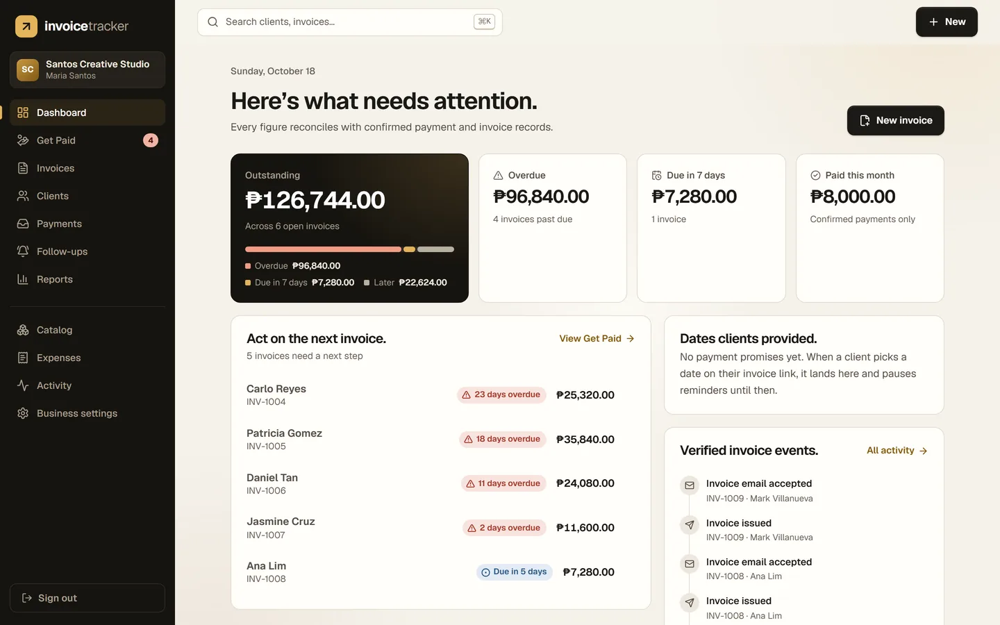
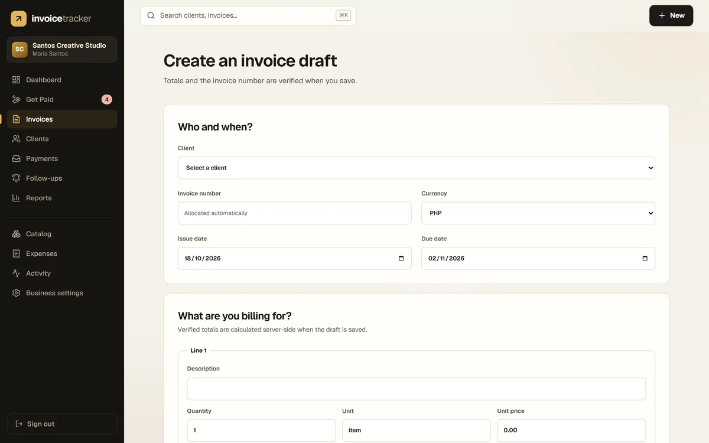
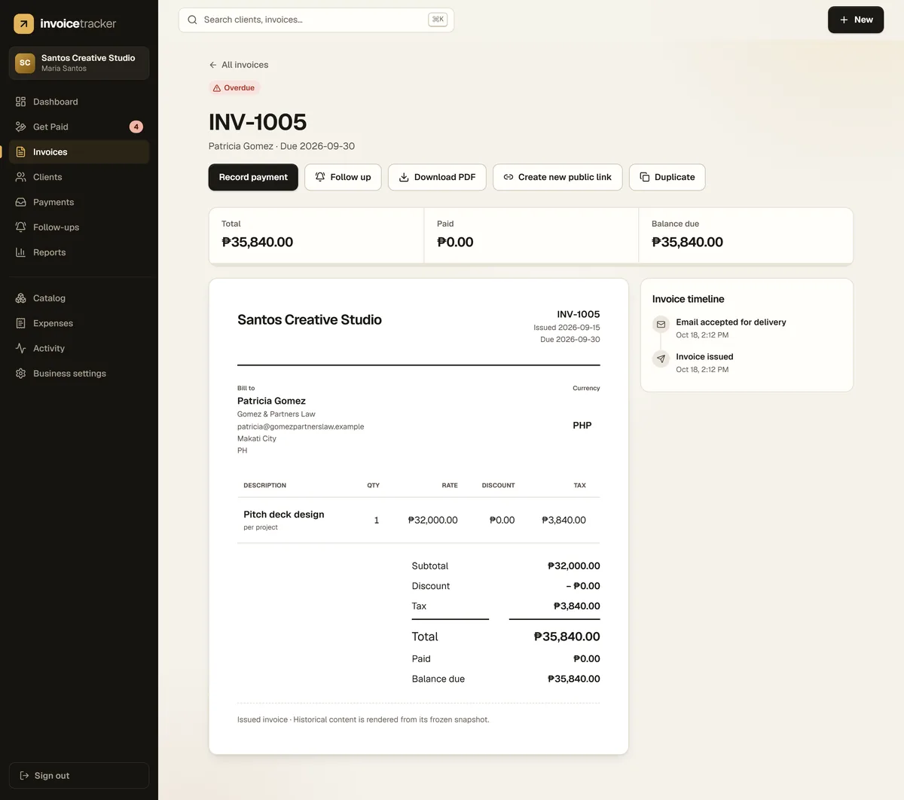
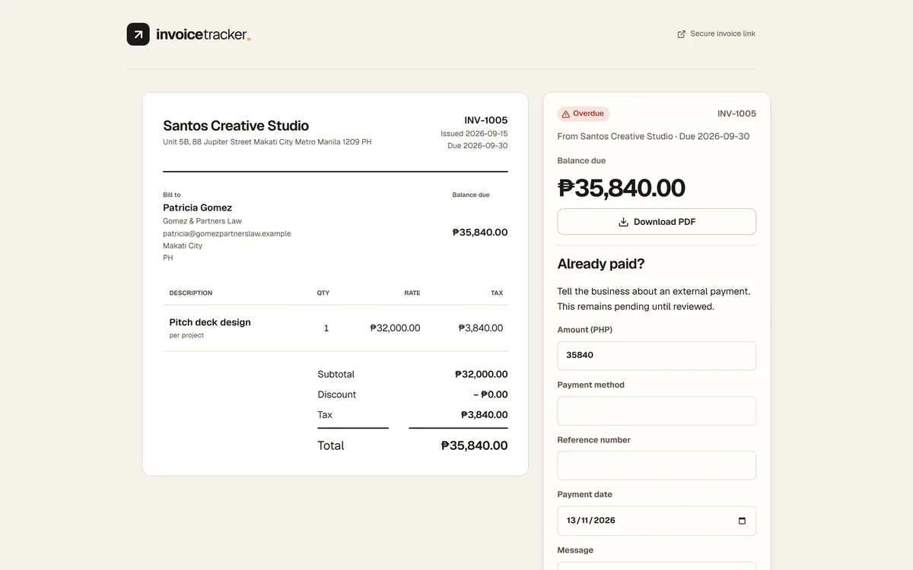
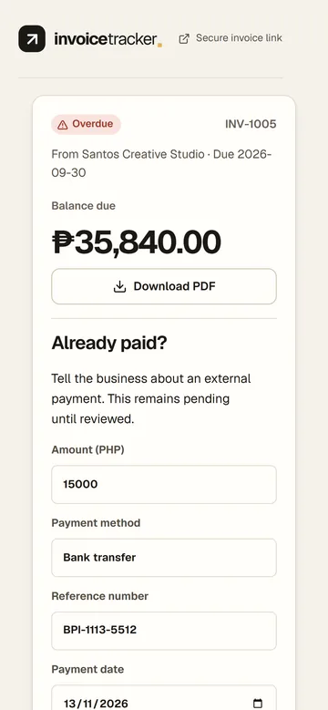
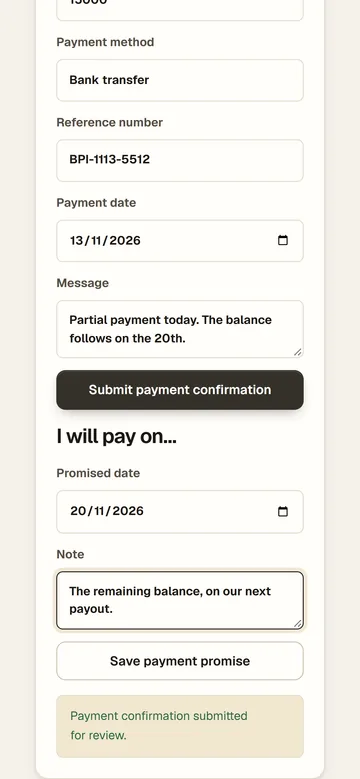
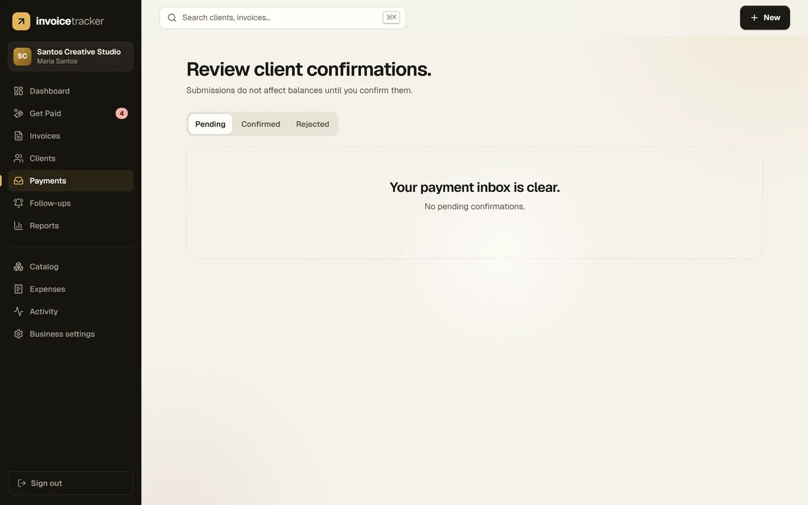
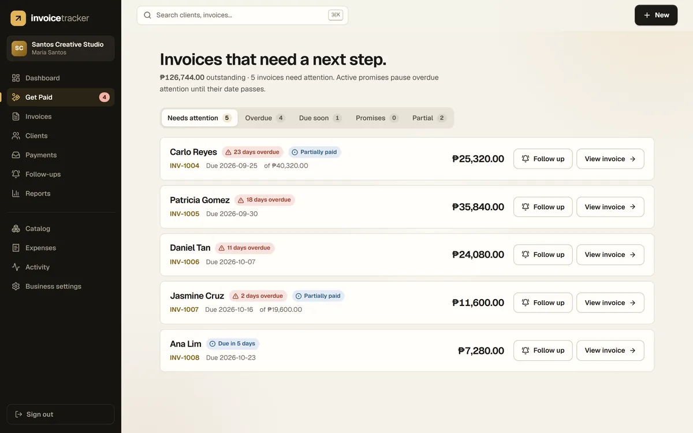
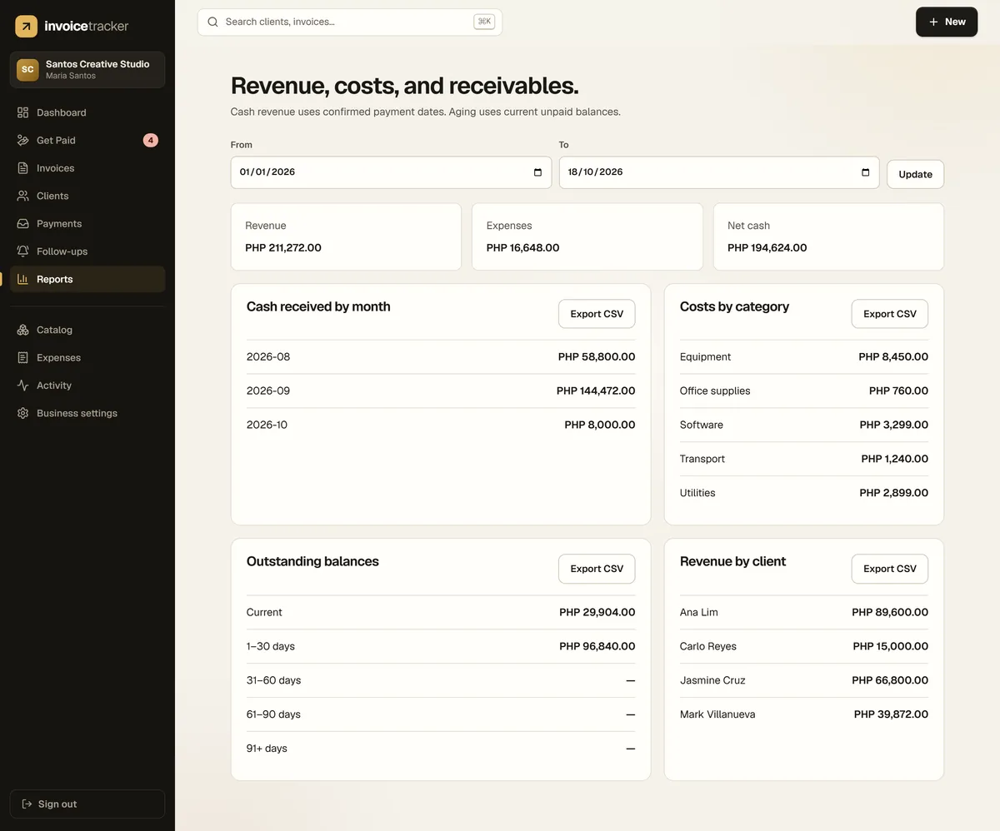

# Invoice Tracker

[](https://github.com/bitwindamountains/invoice-tracker/actions/workflows/ci.yml)

Collection-first invoicing for freelancers and small service businesses: issue invoices, share a secure link with each client, and track partial payments and payment promises until every invoice is paid.

**[Try the live demo →](https://invoice-tracker-demo.onrender.com)** Click **Try the live demo** for your own seeded workspace. No sign-up needed. It runs on free hosting, so the first load can take about a minute.



> **Status:** the core product is complete and tested in CI, and the public demo is live. The real app is not deployed for paying users yet.

## Walkthrough

**1. Draft an invoice.** Pick a client, add line items and dates. The server checks the totals and assigns the invoice number when the draft is saved.



**2. Issue and share it.** Issuing freezes the invoice. The PDF, the public link and the timeline all come from that one snapshot.



**3. The client opens the secure link.** They see the invoice exactly as it was issued, with the balance due and a PDF download.



**4. The client reports a payment or promises a date.** A part payment by bank transfer, with its reference and date, stays pending until the freelancer reviews it. The client can then promise a date for the rest.

<p>
  
  &nbsp;
  
</p>

**5. Confirm payments.** Reported payments wait here. Balances change only after the freelancer confirms them.



**6. Chase what is late.** **Get Paid** lists every invoice that needs a next step, with days overdue, partial payments and promises to check.



**7. Read the numbers.** Revenue from confirmed payments, costs by category, outstanding balances and revenue by client, each exportable as CSV.



## Features

- **Business setup** in four steps: business details, branding, invoice defaults and payment methods (bank transfer, GCash or any method)
- **Clients and catalog** of products and services, with archive instead of delete
- **Invoices** with discounts, tax, multiple currencies and automatic numbering; PDF attachments and PDF receipts
- **Secure client links** where clients view the invoice, report payments and promise dates
- **Payments:** partial payments, owner review of client-reported payments, append-only history
- **Follow-ups:** a reminder sequence with a tone and message for each stage
- **Dashboard, Get Paid queue and reports,** including expenses and CSV export
- **Team roles:** owner and admin can change records; staff can read
- **Installable PWA**, command palette, responsive layouts, accessible forms and reduced-motion support

## Engineering highlights

- **Money is exact:** amounts travel as decimal strings and are stored as PostgreSQL decimals; floating-point values are rejected. Rounding follows written [financial rules](docs/financial-rules.md), and totals in different currencies are never combined.
- **Issued invoices never change:** issuing stores the business, client, lines, totals and payment instructions as an immutable snapshot, so a PDF can never disagree with the record.
- **Payments can't overshoot:** confirming a payment locks the invoice row in a serializable transaction and rejects any amount above the remaining balance. Payment history is append-only.
- **Invoice numbers are safe under concurrency:** numbers are allocated inside the invoice transaction, a failed save doesn't use one up, and a unique constraint is the final guard.
- **Tenant isolation:** every read and write includes the workspace, edits are role-checked and audited, and stale edits are rejected by version checks.
- **Tested in CI:** 44 unit tests, 136 integration checks against PostgreSQL and real HTTP routes, 16 demo-isolation checks, and Playwright browser tests with automated accessibility checks.

## Tech stack

| Part | Technology |
| --- | --- |
| App | Next.js 16 (App Router), React 19, TypeScript (strict), Zod |
| Data | PostgreSQL (Supabase in production), Prisma 7 with the pg driver adapter |
| Auth | Supabase Auth through `@supabase/ssr`, server-side only |
| Documents and email | pdf-lib for PDFs, Resend for email |
| Quality | Vitest, Playwright, ESLint, GitHub Actions |

## Run it locally

Requires Node.js 22.12+ (Node 24 recommended) and npm. Docker isn't needed.

```sh
npm ci
npm run setup:local      # creates random local credentials in an ignored .env (never overwrites one)
npm run db:generate
npm run db:local         # embedded PostgreSQL; leave this terminal running
```

In another terminal:

```sh
npm run db:migrate
npm run dev
```

Open **http://127.0.0.1:3000**. The app and the local database bind to this computer only. The database's data lives in `~/.invoice-tracker/postgres`, outside the project, so database writes don't trigger dev-server reloads. To use your own PostgreSQL instead, set `DATABASE_URL` and skip `db:local`.

### Accounts

Sign-up, sign-in, email verification and password reset use Supabase Auth. Set `NEXT_PUBLIC_SUPABASE_URL`, `NEXT_PUBLIC_SUPABASE_PUBLISHABLE_KEY` and the server-only `SUPABASE_SECRET_KEY`. The app sends verification and reset emails itself, with links back to `APP_URL/auth/callback`.

For development you can skip email verification with `REQUIRE_EMAIL_VERIFICATION=false`; production refuses this setting. With `EMAIL_MODE=file`, invoice and reminder emails are written to `.local/mail/*.json` instead of being sent.

## Checks

With the database and development server running:

```sh
npm run lint
npm run typecheck
npm test
npm run test:integration
npx playwright install chromium
npm run test:e2e
npm run build
npm audit
```

[CI](.github/workflows/ci.yml) runs these against a PostgreSQL service. The integration and browser tests create disposable Supabase accounts and delete them afterwards.

## Production

Use managed PostgreSQL. Set `APP_URL` to the exact HTTPS origin, configure `EMAIL_MODE=resend` with `RESEND_API_KEY` and a verified sender in `EMAIL_FROM`. Production refuses file-mode email and an HTTP auth origin.

Run migrations as a separate release step (`npm run db:migrate`), then `npm run build` and `npm start`. Before launch, complete the remaining gates in [security](docs/security.md). The public demo's setup is in [docs/deployment-render-demo.md](docs/deployment-render-demo.md).

## Project map

- `src/app`: pages and route handlers
- `src/features`: onboarding, clients, catalog, invoices and other feature modules (validation, forms, UI)
- `src/services`: workspace authorization and transactional persistence
- `src/lib`: auth, environment, database, email, session, logging
- `src/components`: app shell, command palette, toasts, shared UI
- `prisma`: schema and migrations
- `tests`: unit, integration and browser tests

## Documentation

- [Architecture](docs/architecture.md) and [API](docs/api.md)
- [Financial rules](docs/financial-rules.md)
- [Security](docs/security.md) and [operations](docs/operations.md)
- [Implementation status](docs/implementation-status.md)
- [Public demo deployment](docs/deployment-render-demo.md)
- [Development notes](docs/dev-notes/): the original specifications, the specification review and design plans
